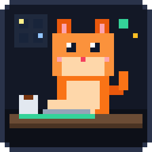
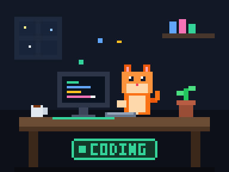
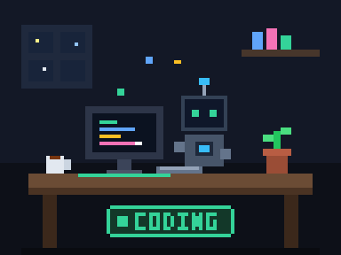
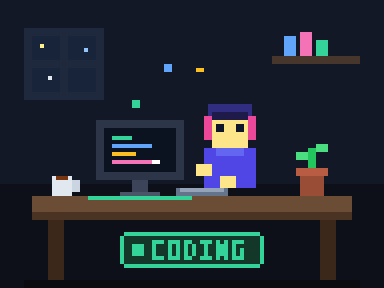

<div align="center">



# Agy Pixel Buddy

**An animated real-time pixel-art companion for Antigravity IDE that reacts whenever AI is thinking, coding, reading files, running terminal commands, or finishing a task.**


</div>

---

## Characters & Animations

Choose from **3 pixel-art buddies** (`cat`, `bot`, `dev`) and **3 selectable human caretakers / whippers** (`boss`, `girl`, `sensei`) who appear during reaction animations (gentle head petting for Cat, comedic whip crack for Bot & Dev):

<table>
  <thead>
    <tr>
      <th align="center" width="33%">Cat (<code>cat</code>)</th>
      <th align="center" width="33%">Bot (<code>bot</code>)</th>
      <th align="center" width="33%">Dev (<code>dev</code>)</th>
    </tr>
  </thead>
  <tbody>
    <tr>
      <td align="center">
        
      </td>
      <td align="center">
        
      </td>
      <td align="center">
        
      </td>
    </tr>
    <tr>
      <td>
        <strong>Cozy Studio Cat</strong><br/>
        • Wagging tail &amp; blinking eyes<br/>
        • Fast paw-typing during <em>coding/terminal</em><br/>
        • <strong>Special Reaction:</strong> Gentle head petting by your chosen caretaker + floating hearts &amp; happy <code>^ ^</code> eyes
      </td>
      <td>
        <strong>Cyberpunk Visor Bot</strong><br/>
        • Antenna &amp; visor LEDs shift color by activity<br/>
        • Scanning visor animation while thinking<br/>
        • <strong>Special Reaction:</strong> Comedic whip crack by your chosen whipper + startled <code>&gt; &lt;</code> visor &amp; sweat drop
      </td>
      <td>
        <strong>Hoodie &amp; Headphones Dev</strong><br/>
        • Signature purple hoodie &amp; pink headphones<br/>
        • Rapid typing &amp; code-scanning glances<br/>
        • <strong>Special Reaction:</strong> Comedic whip crack by your chosen whipper + wide startled eyes &amp; <code>!</code> alert
      </td>
    </tr>
  </tbody>
</table>

---

## Key Features

- **Real-Time Hook Sync**: Listens to Antigravity AI hook events (`SessionStart`, `PreInvocation`, `PreToolUse`, `PostToolUse`, `PostInvocation`, `Stop`) without ever blocking tool execution.
- **Dual Display Modes**:
  - **Sidebar Studio & Status Bar**: A 96×72 night studio scene in the Activity Bar complete with a starry window, steaming coffee mug, reactive monitor, state preview buttons, and a live Status Bar indicator (`Agy: Coding…`, `Agy: Thinking…`, etc.).
  - **Floating Desktop Overlay (Linux X11 + PyQt5)**: A frameless, always-on-top transparent buddy that tracks the focused Antigravity IDE window and can roam freely (*Random Move*) or stay pinned (*Sticky*).
- **Multi-Workspace Aware**: Tracks per-workspace activity independently via `~/.gemini/antigravity/buddy-workspaces.json`.
- **Interactive Reactions (Pet / Whip) with 3 Human Caretakers**: Pick between **Boss (`boss`)**, **Girl (`girl`)**, or **Sensei (`sensei`)** to pet `cat` or crack a whip for `bot`/`dev` on every hook change (`hook`), on new prompts only (`prompt`), on click while `idle`, or via the **Test** button.
- **Bilingual UI (EN & ID)**: Supports both **English** (`en`) and **Bahasa Indonesia** (`id`) across the sidebar, floating bubble, and status bar.

---

## AI State Mapping

| State | Badge (EN / ID) | Triggering Events / Tools | Studio & Overlay Visuals |
| :--- | :--- | :--- | :--- |
| `idle` | `IDLE` / `DIAM` | `SessionStart`, timeout, error/cancel | Steaming coffee mug, screensaver dot, relaxed blinking |
| `thinking` | `THINKING` / `MIKIR` | `PreInvocation`, `PostToolUse`, `PostInvocation` | Thought bubble with pulsing dots &amp; `?`, hand on chin |
| `coding` | `CODING` / `NGODING` | `edit_file`, `write_file`, `replace_file_content`, `dart_fix`, etc. | Fast typing, colorful scrolling code lines &amp; floating particles |
| `reading` | `READING` / `BACA` | `read_file`, `view_file`, `codegraph*`, `grep_search`, `list_dir`, etc. | Scanning eyes, white scanline across monitor, floating page |
| `terminal` | `TERMINAL` | `run_command`, `run_tests`, `manage_task`, `ctx_execute*` | Green `>_` prompt &amp; progress bar on monitor |
| `searching` | `SEARCHING` / `CARI` | `search_web`, `search_marketplace`, `ctx_search`, `browser_*`, `playwright*` | Pulsing purple radar on monitor &amp; search particles |
| `delegating` | `DELEGATING` / `DELEGASI` | `invoke_subagent`, `send_message`, `run_workflow`, `swarm`, `define_subagent` | Multi-agent coordination glow with magenta accents |
| `working` | `WORKING` / `KERJA` | Other tools | Active work state with teal accent |
| `done` | `DONE!` / `SELESAI!` | `Stop` (normal completion) | Celebratory hop, confetti &amp; gold checkmark (returns to `idle` after 5s) |

---

## Installation & Setup

### 1. Install the Extension (`.vsix`)

Build the `.vsix` package or use the prebuilt package in the repository:

```bash
# Option A: Build via bash script (outputs dist/agy-pixel-buddy-0.2.0.vsix)
./scripts/build-vsix.sh

# Option B: Build via Python script (outputs agy-pixel-buddy-0.2.0.vsix)
python3 scripts/package-vsix.py
```

Then install it in Antigravity / VS Code via the Command Palette:
`Extensions: Install from VSIX...` → select the `.vsix` file.

### 2. Floating Overlay Prerequisites *(Optional, Linux X11)*

The Sidebar Webview and Status Bar work out of the box with zero extra dependencies. To enable the **Floating Desktop Overlay** on Linux X11:

- Ensure `python3` and `PyQt5` are installed (`pip install PyQt5` or `sudo apt install python3-pyqt5`).
- Run inside a Linux X11 session (`DISPLAY` environment variable set).

### 3. Antigravity Hook Integration

Configure your Antigravity hooks (`SessionStart`, `PreInvocation`, `PreToolUse`, `PostToolUse`, `PostInvocation`, `Stop`) to invoke `hooks/agy-buddy-hook.js` with `node`:

```bash
node /path/to/agy-pixel-buddy/hooks/agy-buddy-hook.js
```

The hook reads JSON payloads from `stdin`, atomically updates `~/.gemini/antigravity/buddy-state.json` and `~/.gemini/antigravity/buddy-workspaces.json`, and returns standard non-blocking `stdout` responses.

---

## Controls & Commands

### Command Palette

| Command ID | Title | Description |
| :--- | :--- | :--- |
| `agyPixelBuddy.focus` | `Agy Pixel Buddy: Focus Buddy View` | Opens and focuses the Pixel Buddy sidebar view |
| `agyPixelBuddy.cycleCharacter` | `Agy Pixel Buddy: Switch Character` | Cycles through characters (`cat` → `bot` → `dev`) |
| `agyPixelBuddy.toggleFloating` | `Agy Pixel Buddy: Toggle Floating Buddy` | Toggles the floating overlay on or off |

### Floating Buddy Interactions

- **Left-Click & Drag**: Move the buddy anywhere inside the IDE window bounds.
- **Left-Click (while `idle`)**: Trigger the reaction animation (pet / whip).
- **Double-Click**: Instantly switch to the next character.
- **Right-Click**: Open the context menu (Character, Caretaker / Whipper, Movement mode, Status Bubble `Auto`/`Always`/`Off`, Size `2x`/`3x`/`4x`, Language, Reaction trigger, &amp; Test Reaction Animation).

---

## Configuration (`settings.json`)

| Setting | Type | Default | Description |
| :--- | :--- | :--- | :--- |
| `agyPixelBuddy.character` | `"cat" \| "bot" \| "dev"` | `"cat"` | Active pixel character sprite |
| `agyPixelBuddy.trainer` | `"boss" \| "girl" \| "sensei"` | `"boss"` | Human caretaker / whipper character for reaction animations |
| `agyPixelBuddy.floatingMode` | `"random" \| "sticky" \| "hidden"` | `"random"` | Floating buddy behavior inside the IDE window |
| `agyPixelBuddy.language` | `"id" \| "en"` | `"id"` | UI and status bubble language (`id` or `en`) |
| `agyPixelBuddy.promptReaction` | `boolean` | `true` | Enable/disable the pet/whip reaction animation |
| `agyPixelBuddy.reactionTrigger` | `"hook" \| "prompt"` | `"hook"` | Trigger reaction on every hook change or new prompt only |
| `agyPixelBuddy.idleTimeoutSeconds` | `number` (min `10`) | `120` | Seconds before an active state falls back to `idle` |
| `agyPixelBuddy.statusFile` | `string` | `""` | Custom path to `buddy-state.json` (empty = `~/.gemini/antigravity/buddy-state.json`) |

---

## Development & Testing

```bash
# Run JavaScript unit tests
npm test

# Run Python unit tests (floating buddy)
python3 -m unittest discover -s test -p "*_test.py"
```
